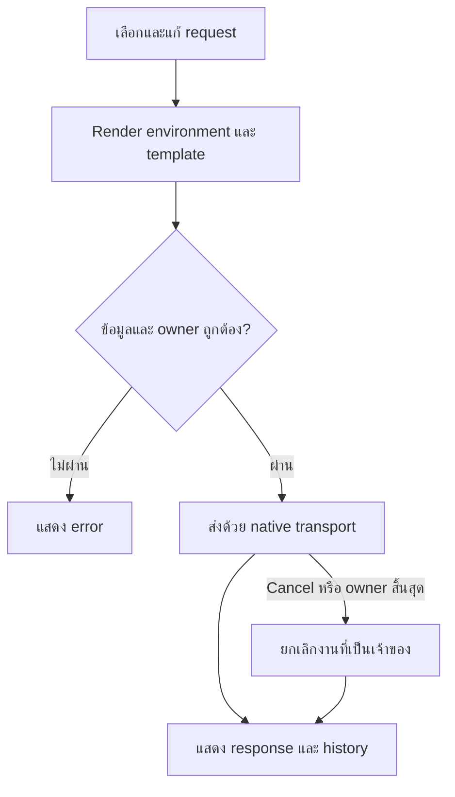
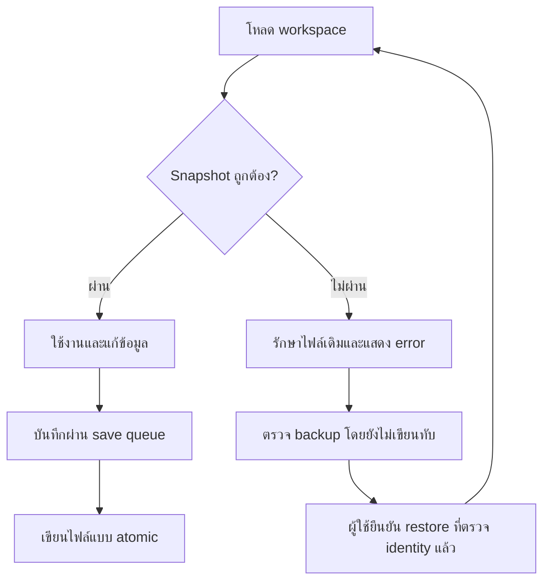
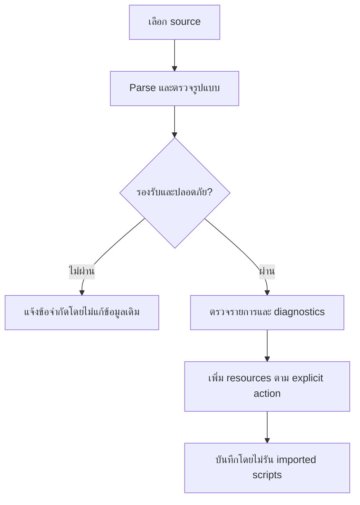
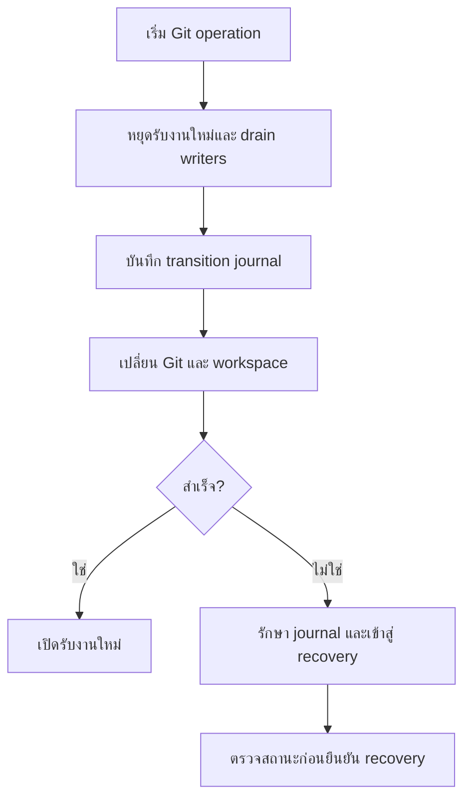
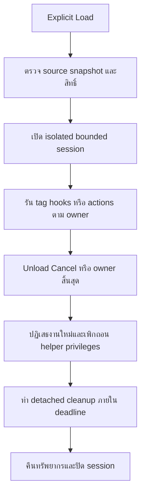

[← กลับ index](0-index.md)

# ขั้นตอนการใช้งาน

## WF-request-send-response

Feature: Requests · MVP: Migration · Latest: New

| Actor | Trigger |
|---|---|
| ผู้พัฒนา API / ผู้ทดสอบ | กด Send หรือ Connect จาก request ที่เลือก |

## WF-workspace-save-recovery

Feature: Storage · MVP: Migration · Latest: New

| Actor | Trigger |
|---|---|
| ผู้ใช้ | แก้ข้อมูล เปิดแอป หรือขอ restore backup |

## WF-import-review-apply

Feature: Import · MVP: Migration · Latest: New

| Actor | Trigger |
|---|---|
| ผู้ดูแล collection | เลือกไฟล์ ข้อความ หรือ legacy directory เพื่อ import |

## WF-git-transition-recovery

Feature: Git · MVP: Migration · Latest: New

| Actor | Trigger |
|---|---|
| ผู้ดูแล collection | เริ่ม Git operation ที่เปลี่ยน workspace |

## WF-plugin-load-retire

Feature: Plugins · MVP: Migration · Latest: New

| Actor | Trigger |
|---|---|
| ผู้ใช้ | Explicit Load plugin หรือ Unload/Cancel/ปิด owner |

