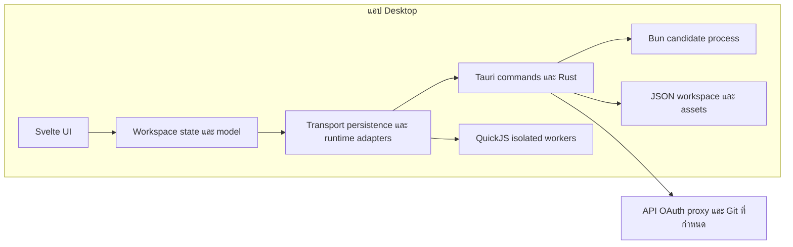

[← กลับ index](0-index.md)

# สถาปัตยกรรม

## Repository

| Repo | หน้าที่ | Language / Framework | พึ่งพา |
|---|---|---|---|
| insomnium-app | Desktop client และ migration จากระบบเดิม | JavaScript, Svelte 5, Tauri 2, Rust | OS WebView, local files และปลายทางที่ผู้ใช้กำหนด |
| `_backup/legacy-electron/` | Reference ระบบเดิมแบบ read-only | Electron / React | ไม่ใช่ runtime ของแอปใหม่ |

## Deploy

| หัวข้อ | ค่า |
|---|---|
| Deploy target | Desktop executable และ installer ตาม platform matrix ใน [CI](migration/CI.md) |
| Environment | Local DEV; integration tests ใช้ local fixtures หรือ nonprod ที่ได้รับอนุญาต |
| Platform scope | Windows / Linux / macOS ตาม retained acceptance โดยไม่อนุมานว่าผ่านครบ |
| Browser preview | Frontend preview ที่มีข้อจำกัด CORS และ storage แยกจาก desktop |

## Tech stack และ source

| ชั้น | เทคโนโลยี / หลักฐาน |
|---|---|
| UI | Svelte 5 / SvelteKit / Vite / JavaScript ตาม `package.json` |
| State | `src/lib/workspace.svelte.js`, `model.js`, `resources.js` |
| Transport | `src/lib/transport.js` และ Rust protocol modules ผ่าน Tauri invocation |
| Persistence | `persistence.js`, `persistence-queue.js`, `src-tauri/src/storage.rs` |
| Desktop data | `workspace-v1.json`, previous backup และ transition journals; ไม่มี relational DB |
| Preview data | `localStorage` key `insomnium-tauri-preview-v1` |
| Plugins | QuickJS เป็น runtime หลัก; `plugin-bun-session.js` เป็น explicit Bun candidate |
| Tooling | Bun 1.4.2+ สำหรับ JavaScript และ Cargo สำหรับ Rust |

## เอกสารและโค้ดที่ต้องแยกความหมาย

| ประเด็น | ข้อเท็จจริงที่ใช้ |
|---|---|
| Git Clone | มี native command registration ใน `src-tauri/src/lib.rs`; [P20](migration/PARITY.md#p20) ยังไม่ยืนยัน implementation และ acceptance ครบ |
| Bun activation | มี implementation และ bounded receipts; dependency QuickJS และ runtime เดิมยังอยู่ |
| UI redesign | มี shared controls ปัจจุบัน แต่ redesign ที่เหลือต้องรอ migration ตาม [POST-MIGRATION-UX](migration/POST-MIGRATION-UX.md) |
| Snapshot build metadata | ไฟล์ BUILD/archive manifest ถูกลบใน working tree; ไม่ใช้ historical snapshot ยืนยัน build ปัจจุบัน |
